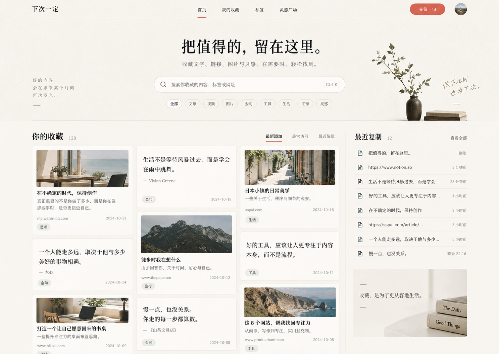
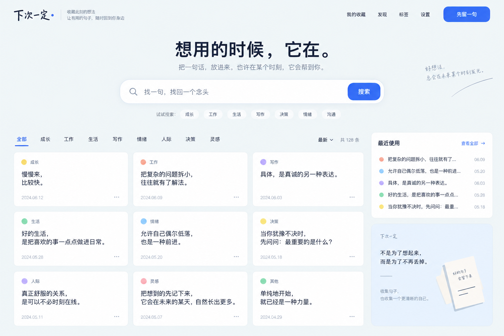

# 后续版本视觉备选

> 状态：待选型。仅作为后续版本的视觉方向参考，不进入当前 V1.0 实现。

当前保留两种 PC Web 首页方向，后续版本从中二选一或融合细节。

## A. 纸感编辑收藏册

### 视觉特征

- 暖白纸张底色、细微纹理和大量留白。
- 书刊式排版与衬线标题，整体更安静、具收藏感。
- 内容区使用克制的卡片与右侧“最近使用”辅助栏。

### 保留范围

保留色彩、排版、信息密度和“个人收藏册”的气质；不代表引入示意图中的图片、外链、文章类型或“灵感广场”等功能。

## B. 轻盈灵感库

### 视觉特征

- 雾蓝背景配深蓝文字，以亮蓝作为主要操作色。
- 居中搜索和整齐的三列内容卡片，轻盈、亲和且更具数字产品感。
- 分类以低饱和色点作辅助识别，右侧保留“最近使用”区域。

### 保留范围

保留色彩、节奏、搜索入口和内容卡片的设计语言；不代表引入示意图中的“发现”、设置页、扩展分类或其他 V1.0 范围外能力。

## 选型边界

- 选型前不改动当前 V1.0 的页面、功能、数据库或 API。
- 视觉选定后，再依据当时的产品需求拆解页面和交互范围。
